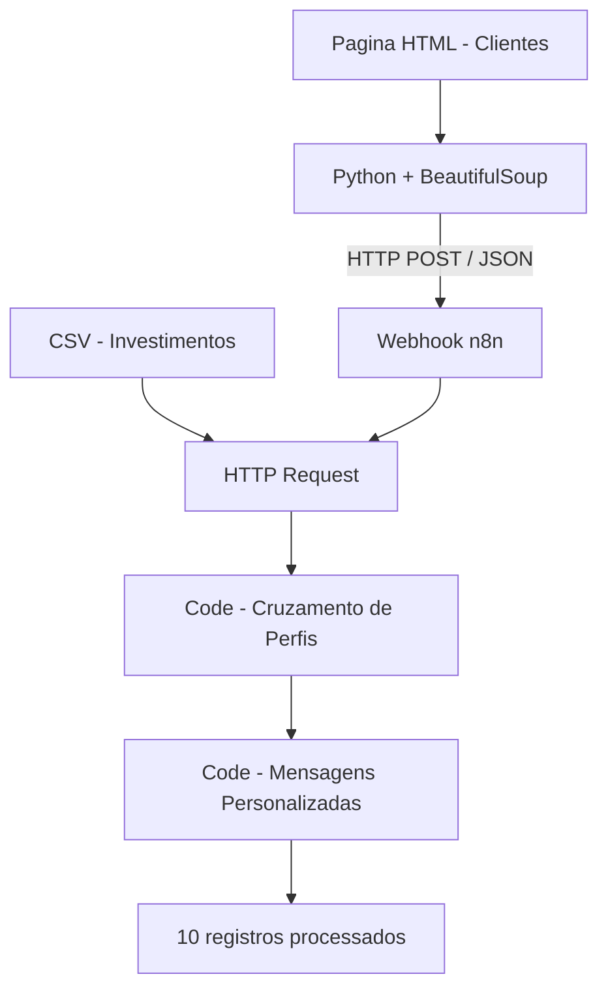

# Assistente de Investimentos | Python + RPA + n8n


> Projeto desenvolvido como parte do Bootcamp Santander - Automacao com n8n, oferecido pela DIO.

## Sobre o projeto

Este projeto demonstra a integracao entre Python e n8n para automatizar a coleta, o processamento e a classificacao de dados ficticios de investidores.

O sistema extrai registros de uma pagina HTML, envia os dados a um Webhook e consulta uma base CSV de investimentos para gerar mensagens personalizadas conforme o perfil e o saldo de cada cliente.

**Objetivo:** demonstrar um pipeline funcional de RPA, integracao HTTP, tratamento de dados e automacao de processos.

## Arquitetura da solucao



## Tecnologias utilizadas

| Tecnologia | Aplicacao |
|---|---|
| Python | Extracao e envio de dados |
| Requests | Requisicoes HTTP GET e POST |
| BeautifulSoup | Leitura e interpretacao do HTML |
| n8n | Orquestracao do workflow |
| JavaScript | Tratamento e cruzamento dos dados |
| CSV e JSON | Formatos de entrada e processamento |
| Git e GitHub | Versionamento e documentacao |
| Docker | Execucao local do n8n |

## Workflow implementado

| Etapa | Node | Funcao |
|---|---|---|
| 01 | Receber clientes | Recebe os registros via Webhook POST |
| 02 | Consulta CSV | Consulta a base de investimentos via GET |
| 03 | Processar CSV e Cruzamento de Perfis | Seleciona produtos por perfil e saldo minimo |
| 04 | Gerar Mensagens Personalizadas | Cria textos personalizados para cada cliente |

### Regras de classificacao

- **Conservador:** foco em estabilidade e seguranca.
- **Moderado:** equilibrio entre seguranca e crescimento.
- **Arrojado:** maior potencial de retorno, com maior exposicao a riscos.

As opcoes sao filtradas pelo perfil do cliente e pelo saldo minimo exigido no CSV.

O projeto utiliza dados ficticios e nao constitui recomendacao financeira individualizada.

## Resultados

O MVP foi validado em ambiente local com:

- 10 clientes ficticios extraidos da pagina HTML.
- Envio dos registros via Python para o Webhook do n8n.
- Consulta HTTP a base CSV de investimentos.
- Cruzamento dos perfis com as opcoes disponiveis.
- Geracao de 10 mensagens personalizadas com templates estaticos.

### Evidencias

As capturas da implementacao estao disponiveis em:

- [Execucao 1](docs/execucao%201.jpeg)
- [Execucao 2](docs/execucao%202.jpeg)

## Estrutura do repositorio

```text
dio-lab-assistente-investimentos-rpa-n8n/
|
|-- docs/
|   |-- index.html
|   |-- data.csv
|   |-- execucao 1.jpeg
|   |-- execucao 2.jpeg
|
|-- src/
|   |-- extrair_clientes.py
|
|-- rpa/
|   |-- extrair_clientes.ipynb
|
|-- n8n/
|   |-- workflow.json
|
|-- README.md
```

## Como executar

### 1. Preparar o ambiente

Tenha Python e n8n instalados. O n8n pode ser executado localmente por Docker.

Instale as bibliotecas Python:

```bash
python -m pip install requests beautifulsoup4
```

### 2. Importar o workflow

No n8n, importe o arquivo:

`n8n/workflow.json`

Configure o Webhook com metodo POST e o caminho `Clientes`.

### 3. Iniciar o Webhook de teste

No node Webhook, clique em **Listen for test event**.

### 4. Executar o script Python

Com o n8n acessivel localmente em `http://localhost:5678`, execute:

```bash
python src/extrair_clientes.py
```

O script utiliza a URL de teste:

`http://localhost:5678/webhook-test/Clientes`

A URL de teste exige que o Webhook esteja aguardando a requisicao e normalmente aceita uma chamada por ativacao.

### 5. Validar o resultado

Confira a execucao no n8n e visualize os registros gerados pelo ultimo node.

O workflow produz mensagens estruturadas em JSON. O MVP nao realiza envio automatico de e-mails.

## Decisoes tecnicas

- **Python + BeautifulSoup:** extracao de dados de uma pagina HTML sem API propria.
- **Webhook POST:** integracao entre Python e n8n por JSON.
- **HTTP Request GET:** consulta da base externa de investimentos.
- **JavaScript:** conversao de dados, comparacao de perfis e geracao de mensagens.
- **Templates estaticos:** implementacao do MVP sem dependencia de uma API paga de IA.

## Evolucoes futuras

- Integracao com modelos de IA generativa.
- Geracao dinamica de mensagens com LLM.
- Tratamento de erros e validacao dos dados recebidos.
- Autenticacao do Webhook para uso fora do ambiente local.
- Persistencia dos resultados em banco de dados.
- Testes automatizados e monitoramento das execucoes.

## Origem e creditos

Projeto desenvolvido a partir do desafio educacional da
[Digital Innovation One (DIO)](https://github.com/digitalinnovationone/dio-lab-assistente-investimentos-rpa-n8n).

Implementacao do MVP, integracao local, organizacao dos arquivos e documentacao realizadas por Alcione Buzo, com apoio de ferramentas de IA durante o desenvolvimento.

---

**Alcione Buzo**

Dados | Business Intelligence | Automacao | Em desenvolvimento para Data Science
